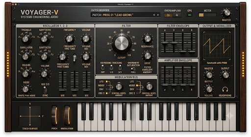

# VOYAGER-V — UI concept (source of truth for editor)

Design reference (UI Agent visual contract):

Agent: **`v-voyager-ui-agent`** · [`../agents/UI_AGENT.md`](../agents/UI_AGENT.md) · roster [docs/V_VOYAGER_AGENTS.md](../../../../docs/V_VOYAGER_AGENTS.md)

## Branding

| Element | Concept |
|---------|---------|
| Product name | **VOYAGER-V** |
| Manufacturer line | **FOUR-STACK MOOG ENGINE · SYSTEMS ENGINEERING AUDIO** |
| **Moog stack** | Four **STACK MODE** switches + lineage badge + accent color |
| Patch line | `PATCH: PROG nn "Name"` · **&lt; / &gt;** preset step buttons |

## Panel zones → current APVTS

| Zone | Concept controls | V Voyager today | Phase |
|------|------------------|-----------------|-------|
| **Oscillator 1–3** | Wave, frequency, fine, mix faders, sync | 3× **mix faders**, fine, wave, octave; mixer drive | **Phase 2** ✓ mix · sync Phase 3 |
| **Noise** | White/pink | Noise level + **Pink** toggle | **Phase 2** ✓ |
| **Filter** | Large cutoff, res, drive, key track, overdrive switches | Cutoff, res, drive, env amt, KB, mixer sat | **MVP** ✓ · oversized cutoff Phase 1 |
| **Filter / Amp env** | ADSR sliders | Dual **vertical ADSR** rows (FILTER / AMP) | **Phase 2** ✓ |
| **Mod bus** | LFO, wheels, routing | LFO row + glide / noise / master | **Phase 2** ✓ |
| **Filter OD** | Overdrive switches | **Mix OD** / **Filt OD** toggles | **Phase 2** ✓ |
| **Output** | Master, headphone, meter | Master + **OUT meter** | **Phase 3** ✓ |
| **Header** | Oversampling, CPU, meter | **OS**  Off/2×/4× + **scope** | **Phase 3** ✓ |
| **Performance** | Keyboard, pitch/mod wheels, X-Y pad | Host MIDI only | Phase 3 (optional mini keyboard) |
| **Visualizer** | Scope | — | Phase 3 |

## Implementation status

- **Phase 1 (this repo):** VOYAGER-V header, **keyboard lineage** selector, patch readout, wood side rails, metal panel, prominent cutoff knob, sub osc, factory preset browser. See [MOOG_FOUR_STACK.md](MOOG_FOUR_STACK.md).
- **Phase 2:** complete (ADSR sliders, mix faders, preset step, pink noise, OD toggles, mod bus layout).
- **Phase 3:** output meter + waveform scope + oversampling (2×/4×). Wheels/mini keyboard remain host MIDI.

When adding parameters, update [PRESETS.md](../PRESETS.md) generator and `SynthParameterIds.h` together.
