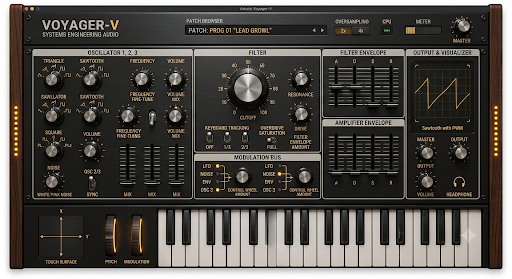

# V Voyager — UI design system

Single source for **tokens**, **layout**, and **components**. Visual hero:



## Document map

| Doc | Role |
|-----|------|
| **This file** | Tokens, layout grid, component rules, DoD |
| [UI_CONCEPT.md](UI_CONCEPT.md) | Zone → APVTS mapping and phase status |
| [../agents/UI_AGENT.md](../agents/UI_AGENT.md) | Agent loop, mockup diff backlog |
| [UI_CONCEPT_VOYAGER-V.png](UI_CONCEPT_VOYAGER-V.png) | Pixel / proportion hero |
| [../VoyagerUiTokens.h](../VoyagerUiTokens.h) | C++ token constants (`voyagerui::`) |
| [../SynthEditor.cpp](../SynthEditor.cpp) | `VoyagerPanelLookAndFeel`, components |

When tokens change, update **this doc** and **`VoyagerUiTokens.h`** in the same change.

## Design principles

1. **Analog panel first** — brushed metal face, wood end-cheeks, warm amber accents (not flat Material UI).
2. **Hierarchy** — filter **cutoff** is the largest control; performance strip is always visible at the bottom.
3. **Lineage theming** — active stack mode recolors accents (knobs, faders, LEDs, toggles); panel chrome stays neutral.
4. **Readability** — section titles left-aligned in inset frames; patch readout centered in header.
5. **No orphan parameters** — every visible control binds to APVTS (or is explicitly documented as visual-only).

## Color tokens

| Token | ARGB | Use |
|-------|------|-----|
| `panelWoodDark` | `#3D2614` | Editor background behind rails |
| `panelWood` | `#6B4423` | Wood rails, section borders |
| `panelMetal` | `#3A3D42` | Main face gradient base |
| `panelMetalHi` | `#5C6168` | Metal highlight, tracks, inactive LEDs |
| `panelInset` | `#25282C` | Section fill, button off states |
| `sectionText` | `#F0F2F5` | Labels, secondary copy |
| `titleGold` | `#E8B44A` | **VOYAGER-V** wordmark |
| `defaultAccent` | `#F4A62A` | Voyager stack default (amber) |

### Stack lineage accents

| Stack | ARGB | `moogstack::Lineage` |
|-------|------|----------------------|
| Voyager | `#F4A62A` | `voyager` |
| Sub Phatty | `#E85D4A` | `subPhatty` |
| Subsequent 37 | `#4EC9E0` | `subsequent37` |
| Model D | `#6FA8DC` | `modelD` |

Implement via `voyagerui::colours::accentForLineage()` — do not hardcode duplicate hex in new UI code.

## Typography

| Role | Size (pt) | Weight | Example |
|------|-----------|--------|---------|
| Product title | 30 | bold | `VOYAGER-V` |
| Subtitle | 11 | plain | `FOUR-STACK MOOG ENGINE · …` |
| Section title (in chrome) | 13 | bold | `OSCILLATOR BANK` |
| Section frame title | 14 | bold | `Oscillator 1 · 2 · 3` (painted) |
| Control row | 11 | bold | `FILTER`, `LFO` |
| Micro / bus | 9 | bold | `MOD BUS A`, `OS` |
| Caption | 8.5 | plain | Scope waveform label |

Constants: `voyagerui::type::*`.

## Layout grid (default editor)

Default window: **1180 × 820** (`voyagerui::layout::defaultEditor*`).

```
┌wood┬──────────────────────────────────────────┬wood┐
│LED │ HEADER (112px): title · patch · stack ·   │LED│
│    │ OS · scope · master                       │   │
├────┼──────────────────────────────────────────┼───┤
│    │ OSC section (195px)                       │   │
│    │ FILTER (148px)                            │   │
│    │ ENVELOPES (158px)                         │   │
│    │ MOD BUS (128px)                           │   │
│    │ PERFORMANCE (94px): XY · wheels · keys    │   │
└────┴──────────────────────────────────────────┴───┘
```

- Wood rails: **44px** (`woodRailWidthPx`); animated accent LEDs on inner edge.
- Content inset: **12px** from metal panel; header content starts at **122px** top trim.
- **Target (hero PNG, not yet implemented):** three columns — osc left, filter+mod center, env+output right. Track in [UI_AGENT.md](../agents/UI_AGENT.md) backlog.

## Components

### `VoyagerPanelLookAndFeel`

- **Rotary**: dark disk, metal ring, accent value arc, pointer, center boss.
- **Vertical fader**: metal channel, accent cap (mix + ADSR).
- Accent colour comes from active lineage (`panelLookAndFeel.accent`).

### Segmented / radio switches

Use `juce::TextButton` radio groups (not combos) for:

| UI | Radio group ID | APVTS |
|----|----------------|-------|
| Stack mode (4) | `88001` | `moogStack` |
| Oversample OFF/2×/4× | `88002` | `oversample` |
| Filter KB OFF/1/3/2/3/FULL | `88004` | `filterKeyTrack` |
| Per-osc wave SAW/SQR/TRI/PLS | `90110 + oscIndex` | `osc1Wave` … |

### `WaveformSelectorStrip`

Four-position strip per oscillator; hidden `ComboBox` retains preset/automation attachments.

### `ModBusMatrixPanel`

Dual columns **MOD BUS A / B**; 4 sources × 2 buses. LEDs are **clickable** (visual routing state; DSP wiring optional).

### `VoyagerPerformanceStrip`

- **TOUCH SURFACE** XY pad → `lfoToFilter` / `lfoToPitch`
- **PITCH** wheel → `osc1Fine` (cents)
- **MOD** wheel → `filterEnvAmount`
- On-screen `MidiKeyboardComponent`

### Section chrome

`drawSection()` — inset fill, inner shadow, wood border, title bar 22px.

### Header patterns

- Patch: `◀` `PATCH: PROG nnn "Name"` `▶`
- Stack: `STACK MODE` + four lineage buttons + badge label
- Output: scope + meter + master knob (top right)

## Branding copy (fixed strings)

| Element | Text |
|---------|------|
| Product | `VOYAGER-V` |
| Manufacturer | `FOUR-STACK MOOG ENGINE  ·  SYSTEMS ENGINEERING AUDIO` |
| Performance section | `Performance — touch · wheels · keyboard` |

## UI change definition of done

1. Read hero PNG + this doc + [UI_CONCEPT.md](UI_CONCEPT.md).
2. Token/layout changes reflected in `VoyagerUiTokens.h`.
3. `cmake --build … --target MoogVoyager` (and Standalone if layout changed).
4. `plugin-factory/scripts/factory.sh release` when touching shipped UI.
5. Standalone screenshot vs mockup in `/opt/cursor/artifacts/` (or PR image).
6. DSP/parameters only with Preset Agent / `SynthParameterIds.h` updates when needed.

## Known gaps vs hero PNG

Tracked in [UI_AGENT.md](../agents/UI_AGENT.md): 3-column layout, headphone output, wave **rotary** art, mod matrix → APVTS, wood proportion pass.
